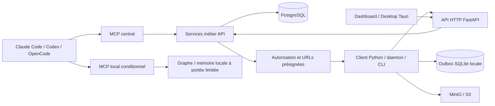

# Workflows actuels — audit du 4 novembre 2026

## Méthode et périmètre

Lecture du checkout, introspection du registre MCP local, lectures MCP distantes limitées à `studio_get_projects` et `studio_prepare_context`. Aucune session, tâche, décision ou réservation créée. Les modifications Git préexistantes sont conservées. « Confirmé » signifie observé dans le code ou exécuté ; « probable » désigne une conséquence fortement étayée ; « hypothèse » demande une expérimentation. Un test présent n'est pas un test exécuté.

## Architecture réelle

Le MCP central importe les services API et leur session SQLAlchemy ; il ne passe pas par le transport HTTP. Les autorisations métier sont partagées avec les routes HTTP. Le client dépend des contrats, de workspaces et de HTTPX, sans dépendre de l'implémentation API. PostgreSQL porte l'état collectif ; SQLite est une file locale, pas une source collective alternative. Les octets de transfert passent directement entre client et stockage. Sources : `services/mcp/pyproject.toml:6`, `services/mcp/src/studio_mcp/errors.py:76-85`, `services/mcp/src/studio_mcp/tools/tasks.py:10`, `services/api/src/studio_api/routers/tasks.py:78-81`, `packages/studio-client/pyproject.toml:5-14`, `README.md:16-20`.

L'orchestration produit n'est pas équivalente au lancement d'un sous-agent par le harnais. Les outils de runtime, task launches et producer jobs existent ; `studio_coordinate` ne fait qu'émettre un signal. Une tâche, une session, un claim de fichier et une exécution de processus sont des objets différents.

## Documenté, implémenté, exposé, testé

| Domaine | Documenté / implémenté | Exposition effective | Tests et limites |
|---|---|---|---|
| Cycle composite | Start L2 et handoff L3 dans TECH/07 ; services et handlers réels | Les deux en session/admin | Tests start/handoff/concurrence présents ; DB non exécutée |
| Contexte progressif | Liens structurels, score lexical explicable, textes tronqués | prepare_context en session ; utilisé sans mutation dans l'audit | Tests pertinence, contrat, budgets présents ; réponse distante observée |
| Coordination | Signaux structurés, UUID stables, quota, lecture via sync | coordinate et sync en session | Tests quotas, replay, même machine présents ; pas de superviseur implicite |
| Définitions | Bibliothèque versionnée, résolution agent/runtime et dépendances | Lecture ciblée en session ; publication/runtime surtout admin | Tests bibliothèque présents ; ne pas confondre avec accès fichiers local |
| Décisions | Proposer puis accepter/superséder selon rôle | Trois outils en session, mais transitions admin seulement | Tests transitions présents ; un profil ne confère pas le rôle |
| Mémoire locale/graphe | Serveur séparé UC-3 avec providers et scope | Trois outils si configurés ; absents de la connexion courante | Tests locaux présents ; aucun graphe local supposé frais sans drapeau |
| Dépréciations | Cinq primitives remplacées par composites/batch | Encore enregistrées, admin en découverte | Quatre tests de dépréciation exécutés ; retrait non appliqué |
| Complétion | Preuves typées selon nature de travail | completion facultative sur handoff local | Vérifie cohérence déclarative, pas véracité Git/CI ; tests présents |

Inventaire complet et schémas exacts : [01-MCP-INVENTORY.md](01-MCP-INVENTORY.md). Les 63 noms locaux correspondent aux 63 noms annoncés ici, sans preuve d'identité des signatures ni du binaire serveur distant.

## A — Initialisation

1. Le protocole permanent demande `studio_start_work` avant exploration (`.agents/rules/studio-protocol.md:5`). Le skill `studio-context` demande au contraire `studio_prepare_context` avant exploration (`.agents/skills/studio-context/SKILL.md:10-18`) ; la description du serveur le présente aussi comme premier appel recommandé (`services/mcp/src/studio_mcp/server.py:117`). **Contradiction d'orientation confirmée**, pas deux obligations à cumuler.
2. L'identité vient normalement du harnais/hook ; `studio_resolve_agent_identity` existe si elle manque. Une identité agent ne remplace ni l'utilisateur ni la machine authentifiée. `studio_resolve_agent` résout une définition et son runtime, pas l'identité technique.
3. Avec tâche, `studio_start_work(project_id, agent_id, task_id, ...)` autorise, revendique la tâche, reprend/crée une session, prépare le contexte et retourne un premier sync sans acquitter son `next_cursor` (`services/api/src/studio_api/services/start_work.py:91-145`). Il faut conserver les IDs, version et curseur retournés.
4. Sans tâche, la branche retourne contexte et candidats sans claim/session (`start_work.py:141-165`). Elle exige néanmoins un rôle writer et un agent possédé (`:47-77`). `prepare_context` est l'entrée naturelle d'un audit à droits de lecture.
5. Le composite est explicitement non transactionnel (`start_work.py:10-12`). Des commits partiels peuvent subsister après échec. Une clé stable améliore le replay ; elle ne transforme pas le composite en transaction.

Dans cet audit, l'interdiction utilisateur de toucher la production prime : pas de démarrage suivi ni de clôture MCP. Le démarrage sûr a utilisé le contexte en lecture seule, sans inventer un flag `audit` inexistant.

## B — Compréhension et exploration

Le contexte inclut tâche, décisions, notes résumées, règles/skills, travaux IA, claims et vue roadmap selon pertinence/budget. `why`, `matched_terms`, `additional_available`, `omitted_for_budget`, `truncated` doivent guider les lectures suivantes. Le classement est lexical et structurel, pas une recherche sémantique : une correspondance ne constitue pas une instruction obligatoire. Sources : `services/mcp/src/studio_mcp/tools/context.py`, `services/api/src/studio_api/services/project_context.py:258-278,1166-1171`.

L'incrémentalité du contexte existe aussi **par hash**, indépendamment du curseur de sync : `prepare_context(known_ids={id: content_hash})` retourne les éléments correspondants avec `unchanged=true`, sans leur texte long. Le handler valide UUID, SHA-256 minuscules et au plus 100 entrées ; un hash périmé rend de nouveau le contenu. Il faut réellement conserver le texte déjà reçu pour exploiter une référence unchanged ; après perte de contexte, ne pas envoyer des hashes dont on ne possède plus le contenu. Sources : `tools/context.py:33-37,53-66`, `services/project_context.py:336-348,532-542,731-739,835-847`, `tests/mcp/test_prepare_context.py:464-500` (test présent, non exécuté ici).

Hub local localise symboles/contexte ; Git décrit la révision et les changements réels ; Graphify sert aux relations, avec fraîcheur à vérifier ; la mémoire personnelle conserve les préférences et faits transversaux. L'état de tâche n'appartient pas au vault personnel. Le lanceur projet Graphify fixe la sortie centrale et refuse une sortie locale accidentelle (`scripts/graphify-studio.ps1:11-25`). Le graphe observé a 19 908 nœuds et date du 29 octobre : c'est un index d'orientation, pas une preuve du checkout du 4 novembre.

La requête Graphify a utilisé des termes attestés dans les labels. Malgré cela, la tokenisation de noms composés a produit 989 nœuds et une réponse tronquée : il faut privilégier un symbole discriminant ou des lectures ciblées, sans conclure sur les nœuds non retournés. Coût LLM local Graphify de cette consultation : aucune extraction/inférence lancée ; coût modèle global de l'audit non mesuré.

## C — Planification

Les outils de création/mise à jour de tâche, roadmap, preview/apply d'hydratation et initialisation de projet sont déjà disponibles. L'agent ne doit pas recréer un plan parallèle si une roadmap active et ses tâches suffisent. `studio_preview_dependency_updates` permet d'étudier les changements de dépendances de bibliothèque ; ce n'est pas une validation automatique de toutes dépendances métier d'une tâche.

Une délégation utile transmet objectif, fichiers bornés, critères et commande de validation. La règle locale demande un agent principal par défaut et un spécialiste sur déclencheur réel (`.agents/skills/studio-task/SKILL.md:34-47`). Les skills globaux de délégation privilégient une équipe pour des livrables indépendants : garder un arbitrage explicite de coût et d'isolation, sans recopier l'historique entier. Aucun plan, agent ni sous-tâche supplémentaire n'est nécessaire pour une correction mécanique unique.

## D — Exécution

- `studio_claim_resources` groupe jusqu'à 50 chemins partageant type et TTL. Le batch n'est pas atomique : chaque claim peut être déjà commit lorsqu'un suivant échoue (`services/mcp/src/studio_mcp/tools/claims.py:161-184,210-260`). L'absence de résultat n'est pas une preuve d'absence de claims.
- Les claims sont des avertissements à TTL, pas des verrous Git ou des protections d'écriture. Un dossier revendiqué recouvre ses descendants ; deux fichiers voisins distincts ne se chevauchent pas nécessairement (`services/api/src/studio_api/services/claims.py:26-53,127-147`).
- `studio_sync(session_id, ack, files, limit, max_chars)` lit les changements pertinents, acquitte ce qui a déjà été traité et touche l'activité de session. Le mode `agent_id + task_id` sans session est stateless, distinct de l'ack persistant (`services/mcp/src/studio_mcp/tools/sync.py:18-43`).
- `coordination` est une donnée citée, jamais une instruction à exécuter aveuglément. Textes de 280 caractères, références bornées, maximum 20 signaux par émetteur (`tools/coordination.py:18-47`). Le destinataire ne reçoit le signal que s'il synchronise.
- Les événements métier de la même machine sont filtrés par sync ; les signaux de coordination entre sessions font exception (`services/api/src/studio_api/services/sync.py:285-304`). Git/lecture explicite restent nécessaires entre agents locaux.

Les checkpoints naturels sont avant une étape longue, un accès partagé ou la clôture, et après un changement pertinent. Un sync après chaque appel local est du gaspillage. À l'inverse, réduire les appels en supprimant toute vérification avant écriture augmente le risque de reprise.

## E — Validation

Le contrat `CompletionEvidence` distingue code, audit, diagnostic et opération ; checks de validation ou constats, exit codes, intégration/CI conditionnelles et déploiement séparé. `CompletionReport.authoritative=False` confirme que le serveur ne certifie pas Git/CI (`packages/studio-contracts/src/studio_contracts/completion.py:9-84`).

**Lacune confirmée :** `completion=None` est permis ; le garde n'est exécuté que si le champ existe. Un handoff demandant `completed` sans preuve passe cette barrière (`services/api/src/studio_api/services/handoff.py:99-109`, `packages/studio-contracts/src/studio_contracts/handoff.py:56`). La discipline du skill reste donc nécessaire ; imposer la preuve serveur serait un changement de compatibilité à décider.

Les tests client et API héritent de fixtures autouse DB/nettoyage stockage, même pour certains tests sans infra intrinsèque (`tests/client/conftest.py:79-92`, `tests/api/conftest.py:60-74`). Le filtrage `not infra` évite ces écritures mais exclut ces validations. Sous xdist, le clone/DROP DB peut commencer avant ce filtrage (`tests/conftest.py:86-95`).

## F — Clôture et reprise

Handoff peut modifier le statut avec `expected_version`, libérer les claims admissibles de l'agent, journaliser AI work si agent+summary, terminer la session et émettre un signal de passation. Ces champs sont en partie facultatifs : un appel réussi ne garantit pas un dossier de reprise complet. L'ancien enchaînement release/end/log ne doit pas remplacer le composite sur erreur.

**Défaut confirmé de présentation/livraison :** le service lit et acquitte le dernier sync avant de fermer, puis MCP compact remplace ses items par des warnings de comptage. Le successeur hérite d'un curseur au-delà de ces messages sans avoir nécessairement vu leur contenu (`services/api/src/studio_api/services/handoff.py:125-132,264-270`, `services/mcp/src/studio_mcp/response_budget.py:211-236`). Un sync explicite avant clôture réduit la fenêtre mais ne supprime pas une arrivée concurrente. `verbose=true` expose les items si la réponse arrive ; ce n'est pas une réparation de la sémantique réseau.

L'agent suivant reprend avec start_work sur la tâche ou prepare_context s'il ne doit pas écrire, puis lit AI work sélectivement si NEXT manque. Une session expirée est un état de présence : start_work peut la remplacer ; sync peut encore la réactiver tant qu'elle n'est pas ended (`sessions.py:305-340,421-446`, `sync.py:233-273`, `tests/api/test_sync.py:299`). Ne pas assimiler expiration à révocation de credentials.

## Risques concurrents restant à reproduire

| Hypothèse | Preuve de chemin non protégé | Test manquant |
|---|---|---|
| Deux updates de tâche à même version peuvent toutes deux passer | `services/api/src/studio_api/services/tasks.py:157-178` compare puis écrit ; `db/models/base.py:31-35` sans mapper de version | Deux sessions DB concurrentes, barrière avant commit ; exactement un succès et un 409 |
| Deux ack peuvent faire régresser le curseur | `services/api/src/studio_api/services/sessions.py:464-475` compare puis commit sans CAS/verrou | Écrire 20 et 10 à partir du même ancien état ; résultat >=20 |
| Un appel idempotent long peut être repris trop tôt | Reclaim à 30 s, sans fencing/heartbeat visible dans `services/api/src/studio_api/services/idempotency.py:71-117` | Premier appel encore vivant >30 s, second même clé ; un seul effet |

Ces risques sont étayés par le code mais non reproduits ; ils ne doivent pas être présentés comme des incidents observés.
