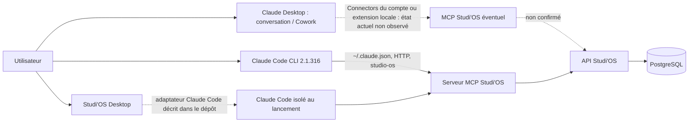

# Claude First — cartographie observée

## Chemins distincts

Les flèches en pointillés sont des chemins possibles ou décrits par le code, mais pas observés en exécution pendant cette mission. La connexion HTTP actuelle du CLI vers le MCP n'a pas réussi au test `claude mcp list`.

## Claude Desktop — conversation et Cowork

Le fichier local `claude_desktop_config.json` ne contient pas de catalogue MCP local. Cela ne permet pas de conclure qu'aucun connecteur distant n'est actif : la documentation Anthropic indique que les serveurs MCP distants se gèrent dans **Settings > Connectors**, tandis que les serveurs locaux sont présentés dans **Settings > Desktop app > Manage > Extensions** (ou l'ancien panneau Developer). Il n'a pas été possible d'inspecter ces panneaux dans l'application réelle; les journaux MCP disponibles sont vides ou anciens. Le compte, les connecteurs actifs, leurs outils, leurs permissions et le modèle de la conversation restent inconnus.

Anthropic distingue les connecteurs MCP distants des extensions locales. Les serveurs distants sont gérés dans les réglages Connectors, pas par le fichier `claude_desktop_config.json` ([documentation Connectors](https://support.claude.com/en/articles/11503834-building-custom-connectors-via-remote-mcp-servers), [documentation MCP Desktop](https://support.claude.com/en/articles/10949351-getting-started-with-local-mcp-servers-on-claude-desktop)).

## Claude Code CLI

Le CLI est installé et authentifié. Dans `~/.claude.json`, `studio-os` est un serveur HTTP de scope utilisateur. Le contenu de l'URL et l'en-tête d'authentification ne sont pas recopiés ici. La configuration projet comporte deux entrées pour le même workspace avec des séparateurs de chemin différents; elles ne déclarent pas `studio-os`. Le catalogue n'est pas joignable depuis la commande testée.

Le dépôt décrit la forme d'intégration Claude Code via `~/.claude.json` et `claude mcp add-json --scope user` dans `docs/DESKTOP_P9_HARNESS_ADAPTERS.md`. L'adaptateur `ClaudeCodeAdapter` sait préparer un lancement isolé dont la configuration MCP stricte ne comprend que Studi'OS; cette mécanique n'a pas été lancée pendant cette mission. Le fait que Studi'OS Desktop puisse préparer ce CLI ne signifie pas que l'application Claude Desktop est elle-même reliée à Studi'OS.

Il existe aussi un mode **Claude Code dans l'application Desktop** distinct d'une conversation Claude/Cowork. Anthropic indique que Claude Code dans le terminal et son application Desktop partagent les fichiers de réglages Claude Code. Si l'utilisateur lance réellement une session Code depuis Desktop, la configuration `~/.claude.json` du CLI peut donc s'appliquer à cette session; ce n'est pas une preuve que les connecteurs de la conversation Claude Desktop sont identiques. Le mode réellement utilisé n'a pas pu être observé ([réglages Claude Code](https://code.claude.com/docs/en/settings)).

## Frontière serveur et catalogue

Le code serveur sélectionne un profil de découverte par connexion. `session` est le profil par défaut et contient 29 outils; `admin` expose la surface enregistrée complète. Cette sélection filtre `tools/list`, mais n'accorde aucun droit métier. Pour HTTP, le profil explicite passe par `X-Studio-Tool-Profile`; sans ce header, le code retombe sur `session`. Les décisions d'accès restent dans les services partagés.

La validation historique P1.5 a observé 63 outils sur un transport stdio direct, contre les 29 attendus pour `session`. L'écart n'est pas reproduit dans cette mission : les six serveurs CLI ont échoué à la connexion et aucun catalogue Claude Desktop n'a pu être lu. Ne pas attribuer le nombre 29 ou 63 à Desktop sans la liste d'outils de sa conversation réelle.

## Protocole Desktop reproductible

1. Dans Claude Desktop, ouvrir **Settings > Connectors** et relever si Studi'OS est connecté. Dans la conversation, ouvrir le bouton `+` puis **Connectors** et noter les outils affichés. Pour un serveur local, consulter **Settings > Desktop app > Manage > Extensions** et son statut.
2. Relever la version depuis **Help > About** (ou l'écran équivalent), le mode utilisé (chat, Cowork ou Claude Code), le modèle visible, le nom du connecteur et le statut, sans copier URL, token ou en-tête.
3. Ouvrir une nouvelle conversation et demander naturellement un audit sans modification d'un projet de test. Garder la trace expurgée des outils annoncés/appelés et vérifier l'absence de session, claim et événement métier.
4. Ne faire aucun scénario avec écriture métier ou signal sur la production. Pour le cycle complet, utiliser une machine, un projet et une base explicitement isolés, puis conserver les IDs d'événement et curseurs expurgés.
